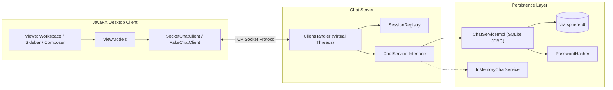

# ChatSphere

[](https://openjdk.org/projects/jdk/21/)
[](https://openjfx.io/)
[](#testing)
[](LICENSE)

**ChatSphere** is a high-performance desktop chat platform written in **Java 21**. It features a modern **JavaFX** client, a concurrent virtual-thread socket server, and dual-backend persistence (SQLite JDBC and In-Memory specification).

---

## Table of Contents

- [Features](#features)
- [Architecture](#architecture)
- [Tech Stack & Prerequisites](#tech-stack--prerequisites)
- [Getting Started](#getting-started)
  - [Build](#build)
  - [Run the Server](#run-the-server)
  - [Run the Client](#run-the-client)
  - [Run Standalone Client (Mock Mode)](#run-standalone-client-mock-mode)
- [Testing](#testing)
- [Project Structure](#project-structure)
- [Protocol Overview](#protocol-overview)

---

## Features

### Client (JavaFX UI)
- **Modern Workspace Layout:** Multi-column interface featuring responsive channel/user sidebar, conversation stream, message composer, and contextual details/search inspector.
- **Optimistic UI:** Messages appear instantly upon sending with optimistic state transitions (`PENDING` ➔ `SENT` ➔ `DELIVERED` ➔ `READ`).
- **Smart Stream Grouping:** Bubbles group dynamically by sender within temporal windows (5-minute proximity), with automatic day separators and unread dividers.
- **Real-Time Indicators:** Ephemeral typing strips and live presence indicators (online/offline tracking).
- **History & Scoped Search:** Paginated message retrieval and full-text keyword search with substring marking, sender/date filters, and conversation scoping.
- **Adaptive Design System:** Light and Dark themes backed by custom CSS tokens, typography scale, and avatar color hashing.

### Server & Backend
- **High-Concurrency Socket Engine:** Virtual-thread-per-connection server architecture with outbound queue management, non-blocking broadcasts, and graceful slow-client disconnect handling.
- **Dual Persistence Contract:**
  - **SQLite (Production):** ACID-compliant transactional persistence using SQLite JDBC and prepared statements.
  - **In-Memory (Testing & Dev):** Concurrent zero-dependency in-memory service mirroring the exact SQLite specification.
- **Security:** PBKDF2 password hashing with constant-time verification to prevent timing attacks.

---

## Architecture



---

## Tech Stack & Prerequisites

- **Language:** Java 21 LTS
- **GUI Framework:** JavaFX 21 (`javafx-controls`, `javafx-fxml`, `javafx-graphics`)
- **Icons:** Ikonli (`ikonli-feather-pack`, `ikonli-javafx`)
- **Database:** SQLite JDBC (`sqlite-jdbc`)
- **Testing:** JUnit 5 (`junit-jupiter`)
- **Build Tool:** Apache Maven 3.9+

---

## Getting Started

### 1. Clone & Build
```bash
git clone https://github.com/Sujal-gupta-05/ChatSphere.git
cd ChatSphere
mvn clean compile
```

### 2. Run the Server

#### Option A: Persistent Database (SQLite)
Stores data in `chatsphere.db` in the working directory:
```bash
mvn compile exec:java
```

#### Option B: In-Memory (No disk storage)
Runs entirely in memory (useful for testing or ephemeral runs):
```bash
mvn compile exec:java -Dexec.args="--memory"
```

### 3. Run the Client

Connects to the server defined in `src/main/resources/config.properties` (default `localhost:5050`):
```bash
mvn javafx:run
```

### 4. Run Standalone Client (Mock Mode)

To explore or test the UI without starting the server, run with the `--fake` flag. This uses `FakeChatClient` pre-loaded with simulated bot interactions, rooms (`#general`, `#random`), and mock direct chats:
```bash
mvn javafx:run -Dexec.args="--fake"
```
> **Pre-seeded credentials:** `demo` / `password1`

### 5. Component Gallery & Dev Harness
```bash
mvn javafx:run -Dexec.args="--gallery"
```

---

## Testing

The project contains a comprehensive test suite across unit, service contract, protocol parser, and socket integration levels:

```bash
mvn test
```

### Test Coverage Highlights:
- **`AbstractChatServiceTest`:** Shared specification tests executed against both `InMemoryChatService` and `ChatServiceImpl` (SQLite).
- **`SocketChatClientTest` & `ProtocolParserTest`:** Frame encoding, decoding, escaping, and socket event pipelines.
- **`ServerCommandsTest` & `ProtocolIntegrationTest`:** End-to-end multi-client socket communication, unread counts, and slow-client buffering.
- **`ConversationViewModelTest` & `WorkspaceViewModelTest`:** Reactive MVVM state, optimistic message sends, and status upgrades.

---

## Project Structure

```text
ChatSphere/
├── pom.xml                               # Maven project configuration
├── docs/
│   └── REPORT.md                         # Technical design report
└── src/
    ├── main/
    │   ├── java/com/chatsphere/
    │   │   ├── client/                   # JavaFX Desktop Client
    │   │   │   ├── component/            # Reusable UI widgets (Avatar, Banner, etc.)
    │   │   │   ├── nav/                  # Scene navigation & view lifecycle
    │   │   │   ├── net/                  # Network client (Socket & Fake implementations)
    │   │   │   ├── state/                # Application state & session models
    │   │   │   ├── theme/                # Theme management & design tokens
    │   │   │   └── view/
    │   │   │       ├── auth/             # Login & Registration views
    │   │   │       ├── dialog/           # Modal dialogs (Settings, Room creation)
    │   │   │       ├── search/           # Message search drawer
    │   │   │       └── workspace/        # Main chat workspace & MVVM viewmodels
    │   │   ├── common/                   # Frozen Shared Contract
    │   │   │   ├── model/                # Data records (MessageRecord, RoomSummary, etc.)
    │   │   │   └── protocol/             # Protocol constants, codec, and validation
    │   │   └── server/                   # Socket Chat Server
    │   │       ├── db/                   # JDBC database connection & migrations
    │   │       ├── net/                  # Socket listener, client handler & sessions
    │   │       ├── security/             # PBKDF2 password hasher
    │   │       └── service/              # SQLite & In-Memory chat service implementations
    │   └── resources/
    │       ├── com/chatsphere/client/css/ # Stylesheets (base, themes, components, workspace)
    │       └── config.properties         # Server host/port configuration
    └── test/                             # Comprehensive test suites
```

---

## Protocol Overview

ChatSphere uses a custom tab-delimited, newline-terminated protocol over TCP sockets:

| Command | Direction | Format | Description |
|---|---|---|---|
| `LOGIN` | Client ➔ Server | `LOGIN\t<reqId>\t<user>\t<pass>` | Authenticate user session |
| `REGISTER` | Client ➔ Server | `REGISTER\t<reqId>\t<user>\t<pass>` | Create user account |
| `MSG` | Client ➔ Server | `MSG\t<reqId>\t<room>\t<text>` | Post message to a room |
| `PM` | Client ➔ Server | `PM\t<reqId>\t<user>\t<text>` | Send direct private message |
| `TYPING` | Client ➔ Server | `TYPING\t<reqId>\t<ROOM\|PRIVATE>\t<target>` | Broadcast typing state |
| `MARK_READ` | Client ➔ Server | `MARK_READ\t<reqId>\t<ROOM\|PRIVATE>\t<target>\t<upToId>` | Advance read marker |
| `HISTORY` | Client ➔ Server | `HISTORY\t<reqId>\t<type>\t<target>\t<beforeId>\t<limit>` | Fetch paginated chat history |
| `SEARCH` | Client ➔ Server | `SEARCH\t<reqId>\t<query...>` | Scoped message search |
| `SENT` | Server ➔ Client | `SENT\t<reqId>\t<msgId>\t<ts>` | Acknowledgement of saved message |
| `MSG_PUSH` | Server ➔ Client | `MSG_PUSH\t<room>\t<msgId>\t<sender>\t<ts>\t<text>` | Incoming room message push |
| `PM_PUSH` | Server ➔ Client | `PM_PUSH\t<msgId>\t<sender>\t<ts>\t<text>` | Incoming direct message push |
| `ACK_PUSH` | Server ➔ Client | `ACK_PUSH\t<DELIVERED\|READ>\t<user>\t<count>\t<ids...>` | Status tick updates |
