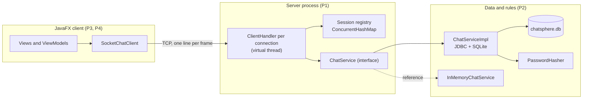
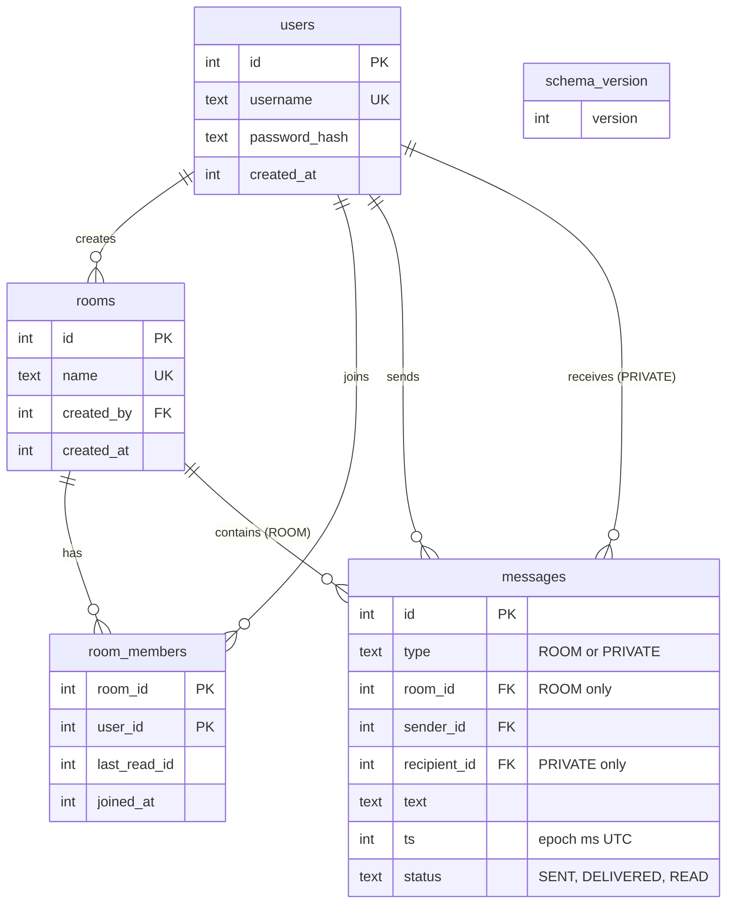

# ChatSphere – Backend Report (data, rules, security, tests)

Scope of this document: the part owned by Person 2 – the database, the business rules behind `ChatService`,
password security, the tests, and the demo data. Networking and the JavaFX client are described only where they
touch this layer. Sections marked **[TEAM]** should be completed by the whole group before submission.

## 1. Problem statement

ChatSphere is a desktop chat application in Java 21: a multi-threaded socket server stores everything in SQLite
through plain JDBC, and a JavaFX client talks to it over a small text protocol. Users register, join rooms, send
private messages, see who is online, and keep their history across restarts. Unread counts, message ticks
(Sent / Delivered / Read), history paging and keyword search must behave identically no matter where the data is
stored. That last requirement drives the design of this layer.

## 2. Architecture

Design decisions that matter:

* **`ChatService` is the only door to the data.** The network layer never sees SQL, and the service never sees a
  socket. "Online" is not a data-layer concept: it lives in the server's session registry, so
  `ChatService.listUsers` always returns `online = false` and the server fills the flag in.
* **Two implementations, one contract.** `InMemoryChatService` is the executable specification.
  `ChatServiceImpl` (SQLite) must behave identically: same error codes, same order of checks, same ordering.
  One abstract test class, `AbstractChatServiceTest`, is run against both.
* **All validation is in the service** (using the shared `Validation` class), so no caller can skip a rule.

## 3. Threading model

* The server handles each connection on its own (virtual) thread, so `ChatService` is called concurrently.
* `ChatServiceImpl` uses **one shared JDBC connection** and `synchronized` public methods. SQLite allows one
  writer at a time anyway, and a single connection avoids lock contention and `SQLITE_BUSY` surprises. Every
  method that changes more than one row runs inside one transaction (`Database.inTransaction`: commit on success,
  rollback on any exception, auto-commit restored in `finally`).
* **Password hashing runs outside the lock.** PBKDF2 is slow on purpose (about 100 ms); holding the lock during
  it would freeze every other user while one person logs in. `register` hashes first and only then takes the lock
  for the insert; `verifyLogin` reads the stored hash under the lock, releases it, and verifies afterwards.
* `InMemoryChatService` uses `synchronized` as well. `concurrent_senders_get_unique_increasing_ids` checks that two
  threads sending at once receive unique, increasing ids on both implementations.

## 4. Protocol summary (frozen contract, Part A4)

* **Framing:** one frame = one line of UTF-8, terminated by `\n`. Fields are separated by TAB. Field 0 is the
  command. Inside a field `\` is `\\`, TAB is `\t`, LF is `\n`, CR is `\r`, so any text (including multi-line
  messages and a literal backslash followed by `n`) survives a round trip. Only `Codec` builds and reads frames.
* **Requests** carry a `reqId` in field 1 and get exactly one reply with the same `reqId`: `OK`, `ERROR`,
  `LOGIN_OK`, `PONG`, `SENT`, or a `*_RESULT` frame.
* **Pushes** have no `reqId`: `MSG_PUSH`, `PM_PUSH`, `USER_STATUS`, `TYPING_PUSH`, `ACK_PUSH`,
  `ROOM_MEMBERS_CHANGED`, `SESSION_REPLACED`.
* **Ordering rule:** for a private message the sender always sees `SENT` before `ACK_PUSH DELIVERED`.
* **Errors:** `ERROR <reqId> <CODE>`; the code set is the `ErrorCode` enum. Unknown codes map to `SERVER_ERROR` on
  the client so a newer server never crashes an older client.
* **Limits** (`Limits`): username 3–20 `[A-Za-z0-9_]`, password 8–100, room 3–30 `[A-Za-z0-9_-]`, message ≤ 2000
  chars, history default 50 / max 100, search max 100, frame ≤ 65 536 bytes.

## 5. Database

### 5.1 ER diagram

### 5.2 Design notes

* **One `messages` table for both kinds.** A `CHECK` constraint enforces that a `ROOM` row has a room and no
  recipient, and a `PRIVATE` row has a recipient and no room. The database itself refuses inconsistent rows
  (tested in `database_rejects_inconsistent_rows`).
* **Ids are `INTEGER PRIMARY KEY AUTOINCREMENT`,** so an id is never reused. Message ids increase strictly,
  and history paging uses "id < beforeId", never offsets, so a new message arriving mid-scroll cannot shift a page.
* **Unread for rooms is a read marker, not a flag per message.** `room_members.last_read_id` stores the newest id
  the member has seen. Unread = messages in the room with `id > last_read_id` from other people. Joining sets the
  marker to the newest id (old history is not "unread"); `markRoomRead` only moves it forward and never past the
  newest existing id, so future messages are never hidden by an oversized client value.
* **Unread for private chats uses the message status:** SENT or DELIVERED messages addressed to me count; READ do
  not. Statuses never move backwards: delivery updates use `WHERE status = 'SENT'`, read updates use
  `WHERE status <> 'READ'`.
* **Indexes:** `idx_msg_room(room_id, id)` for room history, `idx_msg_pm(sender_id, recipient_id, id)` for private
  history, `idx_msg_rcpt(recipient_id, status)` for unread and offline delivery.
* **Pragmas:** `foreign_keys = ON`, `journal_mode = WAL` (readers do not block the writer, and a crash cannot
  corrupt the file), `busy_timeout = 5000`.
* **Schema versioning:** a `schema_version` table (one row, version 1) and a `migrate()` hook, so a later schema
  change is an `ALTER TABLE` plus a version bump rather than "delete your database".
* **Rooms and messages are never deleted.** Leaving a room removes only the membership row.

## 6. Security

| Topic | What we do |
|---|---|
| Password storage | PBKDF2WithHmacSHA256, 120 000 iterations, 16-byte random salt per user, 256-bit hash. Stored as `pbkdf2$iterations$salt$hash`, so the cost can be raised later and old hashes still verify. |
| Comparison | `MessageDigest.isEqual` (constant time). |
| User enumeration | `verifyLogin` returns the same `BAD_CREDENTIALS` for "no such user" and "wrong password", and runs a dummy PBKDF2 verification for unknown users so the response time does not reveal which usernames exist. |
| SQL injection | Every statement is a `PreparedStatement`; user input is never concatenated into SQL. The few dynamic fragments (search filters, sort direction) are fixed strings chosen by code, never taken from input. `sql_injection_attempts_are_harmless` tries hostile usernames, room names, passwords and message text. |
| `LIKE` wildcards | Search escapes `%`, `_` and `\`, so a search for `100%` matches the text "100%" and not everything. |
| Hardened hash parsing | A malformed stored value never matches and never throws; an absurd iteration count in a stored value is refused (prevents a CPU-exhaustion trick). |
| Logging | SQL parameters and message text are never logged. |

**Not secured (by design, out of scope):** the socket is **plain TCP, not encrypted**. Anyone who can sniff the
network can read messages and capture passwords in transit. A real deployment would wrap the socket in TLS
(`SSLServerSocket`) or put the server behind a TLS proxy. There is also no rate limiting on login attempts, no
account lockout, no password reset, and no authorization beyond membership checks.

## 7. Testing

### 7.1 Strategy

| Suite | What it proves |
|---|---|
| `AbstractChatServiceTest` (contract, 40 scenarios) | The behavior of `ChatService`: validation order, every error code, room rules, unread arithmetic, delivery and read transitions, history paging without gaps or duplicates, limit clamping, `historyAround` windows and edges, search visibility / filters / limits, and a concurrency smoke test. |
| `InMemoryChatServiceTest`, `SqliteChatServiceTest` | Both extend the contract, so SQLite is held to the reference implementation, not to opinions. |
| `SqliteChatServiceTest` extras | Data survives close and reopen; reopening does not wipe; passwords are not in the file's bytes and equal passwords get different hashes; SQL injection attempts; schema version row written once; the database rejects inconsistent rows. |
| `PasswordHasherTest` | Format, salts, wrong passwords, Unicode, malformed stored values, old iteration counts, timing parity of `dummyVerify`. |
| `ProtocolIntegrationTest` | Real sockets, real SQLite, protocol spoken only through `Codec` and `Protocol`, 2-second read timeout so a missing frame fails instead of hanging. 14 scenarios: register/login/errors, rooms with `ROOM_MEMBERS_CHANGED`, room push without echo, multi-line and backslash-n round trip, PM ordering (SENT before DELIVERED), offline delivery at login, `MARK_READ` to `ACK_PUSH READ`, history paging 50/50/20, search with filters, typing, presence, `SESSION_REPLACED`, malformed frames, restart persistence. |

### 7.2 Results

Run on 2026-11-19, JDK 21: **107 tests, 107 passed, 0 failed** (40 contract scenarios × 2 implementations, plus
the SQLite-only, hasher, and protocol tests). See the note in the README about which server the integration test
ran against.

## 8. Known limitations

* **Search is ASCII case-insensitive only.** SQLite's `LIKE` ignores case for A–Z but not for other scripts, so
  searching "ä" will not find "Ä". `InMemoryChatService` deliberately folds ASCII only, to stay identical.
* **No encryption on the wire** (see section 6).
* **Single connection, serialized access.** Correct and simple, but throughput is limited to one database
  operation at a time. Fine for a classroom-scale chat; a pool and finer locking would be needed for more.
* **Presence is in memory** and is lost on a server restart (everyone reconnects, so it rebuilds itself).
* `listRooms`/`listUsers` compute unread and previews with correlated subqueries per row. Acceptable for
  dozens of rooms and users; it would need a denormalized counter at larger scale.
* Room messages have no per-reader read receipts (rooms show Sent only).
* No message edit/delete, no file upload, no password change.

## 9. Future work

TLS for the socket; login rate limiting; password change and reset; message edit/delete with a tombstone status;
connection pool and a per-conversation `last_message_id` column to speed up lists; SQLite FTS5 for fast
full-text and Unicode-aware search; a proper migration runner using `schema_version`.

## 10. How to reproduce the results

See the README, section "Run the tests". **[TEAM]** Add your own measurements (screenshots, timing of the demo
checklist) here before submission.
